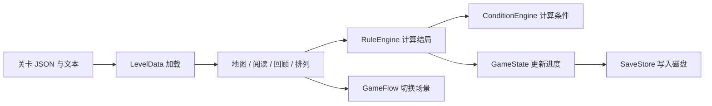

# WILL Godot 项目：从这里开始

这个项目已实现“地图选信 → 阅读 → 回顾 → 排列字条 → 决定结局 → 重试”的核心循环。
正式内容目前是 `0001「浮生梦」` 单人关卡；自动测试覆盖单人、双人及三人关卡。三人可运行示例见本文末尾。

## 1. 第一次运行（约 5 分钟）

1. 使用本机 Godot 4.7.2，导入 `D:/WILL/will-game/project.godot`。
2. 等待资源导入完成，按 **F5**。游戏从地图 `scenes/map/map.tscn` 开始。
3. 点击信箱，取信，再点击信件节点进入阅读。
4. 点击推进文字，读完进入回顾。单人关卡可直接点“开始”；首次双人关卡先读“另一封”。
5. 在排列界面拖动白色字条，点“决定”。`0001` 的 S 条件是 **A3 → A1 → A2**。
6. 新 S 结局会播放倒计时和变化后的内容，之后进入白底结算状态。“再试一次”恢复可编辑状态。

**F5** 运行整个游戏，**F6** 只运行当前场景。调试完整流程优先使用 F5；直接运行某个场景可能缺少它需要的前置状态。

## 2. 先认识这几个词

| 名词 | 可以怎样理解 |
|---|---|
| 场景 `.tscn` | 一张界面及其控件树 |
| 脚本 `.gd` | 控件的行为和游戏规则 |
| 自动加载 Autoload | 切换界面后仍然存在的全局对象 |
| `res://` | 项目根目录，也就是 `will-game` |
| `user://` | 玩家数据目录，存档放在这里 |
| 行 L / R | 左侧和右侧的信件；条件函数中的行号分别是 0 / 1 |
| 句子 ID | 字条的身份证。文字和位置可以变，ID 保持不变 |
| `conditions` | 从上到下判断的规则，第一条命中就决定结局 |

## 3. 想改什么，打开哪里

| 需求 | 文件 | 修改内容 |
|---|---|---|
| 改信件正文 | `data/levels/0001.txt` | `msgstr` 中的文字，保留 `msgctxt` 键 |
| 改字条数、顺序、结局 | `data/levels/0001.json` | `strips / order / endings / conditions` |
| 添加关卡入口 | `data/levels/levels_index.json` | `levels` 和地图 `positions` |
| 改角色名字、颜色、背景、动画 | `data/characters.json` | 对应角色的配置 |
| 改白色字条的字号、颜色、色标 | `scenes/arrange/strip_view.gd` | 纯外观组件 |
| 改拖动虚影、落座动画 | `scenes/arrange/card.gd` | 字条交互 |
| 改插入位置与吸附范围 | `scenes/arrange/drop_column.gd` | 栏目接收拖放 |
| 改落点阴影颜色、大小、柔边 | `scenes/arrange/drop_shadow.gd` | 黑色合法落点 / 红色非法落点 |
| 改排列布局和决定流程 | `scenes/arrange/arrange_board.gd` | 单/双人布局、按钮、锁定 |
| 改地图细节卡外观 | `scenes/map/map_detail_card.gd` | 标题、边框、结局方块 |
| 改地图位置、相机、生长动画 | `scenes/map/map.gd` | 地图行为；管件连线在 `map_route.gd` |
| 改文字出现速度、分页 | `scenes/letter/letter_reader.gd` | 阅读界面 |
| 改回顾滚动 | `scenes/recap/recap.gd` | 滚轮、拖动、惯性 |
| 改存档及奖励规则 | `autoload/game_state.gd` | `record_verdict` 和状态更新 |
| 改条件计算 | `scripts/core/condition_engine.gd` | 函数语义和表达式解析 |

先改数据、运行、观察结果。不要为了改一句话去修改判定引擎。

## 4. 代码怎样合作



- **LevelData**：加载数据、查找句子、处理 REPLACE / DRA / D。
- **ConditionEngine**：回答“一条条件是真还是假”，不改存档。
- **RuleEngine.evaluate**：计算结果，不保存；用于预览和测试。
- **RuleEngine.judge**：计算后调用 GameState 保存；正式点“决定”用它。
- **GameState**：持久进度的唯一入口，同时保存当前阅读和排列状态。
- **SaveStore**：只负责 JSON 校验、备份与文件写入。
- **GameFlow**：统一管理场景路径和切换错误。

一张字条分成三件事：`StripView` 创建外观，`Card` 处理拖起和归位，`DropColumn` 决定放在哪儿。
地图细节卡也只负责显示，不会自己改存档或跳转场景。

### 从“决定”按钮读懂程序

1. `ArrangeBoard._on_execute_pressed()` 检查是否可以编辑；拖动中和倒计时中不接受提交。
2. 读取每一栏的句子 ID 顺序。
3. `RuleEngine.judge()` 按条件表从上到下找第一条命中项。
4. `GameState.record_verdict()` 记录当前结局、历史、排列和奖励，再保存。
5. 新结局播放倒计时；期间卡片、重复决定、重置和返回均被锁定。
6. 需要重放时进入阅读；最后回到白底锁定界面。

## 5. 安全地改一个关卡

当前 `0001` 的 S 条件：

```json
{ "expr": "SS(A3,A1,A2)", "ending": "S1" }
```

它表示 A3 在 A1 前，A1 在 A2 前。**不要求紧挨着**。如果要求相邻，使用 `OS(A3,A1)`。

| 表达式 | 含义 |
|---|---|
| `SS(A1,A2)` | A1 在 A2 之前 |
| `OS(A1,A2)` | A1 紧挨在 A2 前 |
| `OSS(A1,A2)` 或 `S(A1,A2)` | 两者相邻，方向不限 |
| `IN(L,A1)` | A1 现在位于左侧信件 |
| `CURRENT(0001,0,S1)` | 0001 左行当前是 S1 |
| `ACHIEVE(0001,0,S1)` | 0001 左行曾经达成 S1 |
| `ELLE(0001,0,S1,BAD1)` | 0001 左行曾达成所列任一结局 |
| `READ(0001,0)` | 0001 左行已读 |
| `SRANK(0001)` | 0001 曾获得 S 评级 |
| `STORY(INTRO)` | 存档包含 INTRO 剧情标志 |
| `&& / || / !` | 并且 / 或者 / 不满足；可以用括号组合 |

`CURRENT` 和 `ACHIEVE` 的区别：先获得 S1，再改成 BAD1，此时 CURRENT S1 为假，ACHIEVE S1 仍为真。

### 修改步骤

1. 先备份或使用 Git 保存现有版本。
2. 增加字条时给它唯一 ID；若有 `order`，同时把新 ID 加进去。
3. `order` 必须包含本行所有固定句、字条和只读句；变体不放入初始排列。
4. 新增 `REPLACE` 时，`data` 指向 `variants` 的 ID；该变体的 `base` 指向原句。
5. `DRA` 和 `D` 都表示结算展示中删除对应句子。“再试一次”会恢复原句。
6. `conditions` 最后一项保留空表达式兜底，例如 `{"expr":"","ending":"BAD1","fallback":true}`。
7. 运行下方的一键检查，再用 F5 体验一次。

原始排列存在 `GameState.sequences`；结算展示的删除不会破坏它。跨栏后发生变化，重放按字条**现在所在的行**决定。

## 6. 存档规则（改程序前先读）

- 真正写入磁盘的是 **`GameState.save_data`**，版本号为 3（兼容旧版 1/2）。
- `save_data.rows["0001:L"]` 存这一行的 `read / achieved / current / rep / revealed`；排列统一存于 `save_data.levels["0001"].sequence`。
- `history / sranks / read_rows / unlocked_endings` 是重新生成的查询索引。不要直接赋值修改它们。
- 正式进度通过 `set_row_read / set_row_revealed / mark_level_entered / record_verdict` 更新。
- 声望采用本项目规则：**旧格式每关每结局奖励一次，独立格式每行每结局奖励一次**。重试和重放不会重复奖励。旧档原有总额保留。
- 旧关卡保留整关结局；新关卡可在每行设置 `endings` / `conditions`，各行独立结算和领奖。
- 每次保存先写 `save.json.tmp`，完整写入并校验后备份有效旧档，再替换 `save.json`。
- 主档损坏会尝试 `save.bak.json`；主档和备份都坏时保留原文件，拒绝自动覆盖。
- 启动时读档；正常返回地图使用内存进度。保存失败时不会用磁盘旧档冲掉当前内存进度。
- Windows 默认位置通常是 `%APPDATA%/Godot/app_userdata/WILL_game/`；以 Godot 的用户数据目录为准。

旧文档的 `to_dict/from_dict` 并不是原来的实际磁盘保存路径，已移除。当前实现以本页和源代码为准。

## 7. 一键检查

在 PowerShell 中执行：

```powershell
powershell -ExecutionPolicy Bypass -File D:\WILL\will-game\tools\run_checks.ps1
```

换电脑后如果找不到引擎，明确指定：

```powershell
powershell -ExecutionPolicy Bypass -File D:\WILL\will-game\tools\run_checks.ps1 -GodotPath "你的 Godot 可执行文件完整路径"
```

脚本执行：资源导入 → 核心回归 → 单人/双人完整流程 → 拖拽预览检查。失败、脚本报错、未完成或超时都会返回非零退出码，详细日志位于输出提示的系统临时目录。

核心测试会故意损坏**测试存档**来检查恢复能力，因此相关 WARNING 是预期输出。两个套件分别使用 `core_regression_save.json`、`flow_probe_save.json`，不会写入玩家的 `save.json`，结束会清理测试存档。

只查关卡数据：在 Godot 脚本编辑器打开 `tools/validate_levels.gd` 并运行。旧 `map_smoke_test`、`map_visual_test` 等是依赖历史数据的手工探针，不作为当前自动验收入口。

## 8. 常见问题

- **重启后还是白底、不能拖？** 已完成关卡重新进入会恢复结算态，点“再试一次”。
- **改文本后没变化？** 确认改了正确的 `msgstr`，停止并重新运行游戏；文本表在进程内有缓存。
- **显示 `0001_A1` 而不是正文？** `text_key` 找不到对应文本条目。
- **新关卡不在地图？** 检查索引登记、unlock 条件、previous 和 positions；查看校验输出。
- **不应该解锁却解锁了？** 检查是不是把 CURRENT（当前）写成了 ACHIEVE（历史），或提前放了空表达式。
- **添加第三行后提示错误？** 三人关卡需 `row_count: 3`，且 L、R、M 行各出现一次；独立模式每行都要有条件表和兜底结局。

## 9. 边界与后续工作

本轮修复现有核心玩法并整理入口；尚未完成特殊纸条冲突规则、完整音频/演出播放器、原版数据批量转换、多分辨率画面对照验收。

原设计资料仍留在 docs 中，包含规划和旧实现。当前入门以本页为准；旧版长篇 README 保存在 [history/README-旧版.md](history/README-旧版.md)。

### 最新拖拽效果

拿起纸条时原位置不留边框，其他内容自动补位。浮起纸条是实色灰纸，倾斜 -3 度。合法插槽显示略小于纸条的柔边黑色阴影并预留落座空间；顶部固定块前、末尾固定块后等非法位置显示红色阴影，松手自动归位。

- 吸附半径：`drop_column.gd` 的 `SNAP_MARGIN = 180`，排列主界面共用同一数值。
- 阴影内缩与柔边：`drop_shadow.gd` 的 `INSET` 和 `SOFT_EDGE`；中心浓度 `BODY_ALPHA = 0.32`，柔边浓度 `EDGE_ALPHA = 0.16`。
- 拿起颜色及倾斜角度：`card.gd` 的 `build_drag_preview()`。预览复制原内容树，保留正文位置、富文本换行与垂直居中。
- 边缘抗锯齿：预览纸面使用 1.5 像素柔边；项目启用 2D MSAA 4×（当前 Forward+ 渲染器支持）。
- 专项测试：`tools/drag_preview_probe.tscn`。带窗口运行并加 `-- --capture` 可将有效/非法预览截图写到用户数据目录。

- 纸条正文字号统一为 32，在 `strip_view.gd` 的 `FONT_SIZE` 调整，拖动预览同步沿用。
- 鼠标悬停白纸时底色变暗，移开恢复；亮度在 `card.gd` 的 `HOVER_PAPER_COLOR` 调整（当前 0.88，拿起时为 0.78）。


### 排列界面入场动画

进入界面、点击“原始状态”或“再试一次”后，内容按屏幕位置从上到下出现，同高度先左后右。每块先放大无字底板，再淡入文字，时长和启动间隔以 `entrance_animation.gd` 当前常量为准。演出期间暂停拖放和判定，仍可返回或点击原始状态重播。

时长集中在 `scenes/arrange/entrance_animation.gd`：`BLOCK_DURATION` 为单块总时长，`BLOCK_INTERVAL` 为启动间隔，`GROW_DURATION` 为底板放大时长，剩余时间显示文字。布局保留最终占位，缩放不会把其他块挤来挤去。专项检查为 `tools/entrance_probe.tscn`。


### 人物滑入

- 单人从左侧进入，双人分别从左右侧进入；人物内部动画保持播放。
- 读信（包括决定后的信件演出）和首次排列播放；从地图重新进入也播放。判定演出结束返回排列结算态不播放，“原始状态”和“再试一次”不重播人物滑入。
- 时长为 0.75 秒，在 `scripts/ui/character_anim.gd` 的 `SLIDE_DURATION` 调整；落点使用场景中动画槽原位置。
- `GameFlow.previous_scene` 记录此次切换的来源，用于区分地图重进与结算返回。它是临时流程状态，不写入存档。
- 角色须有行级 `anim` 或角色配置中的 `anim`；缺少动画的槽仍隐藏。LRM 入场规则待定。


## 10. 三人排列与独立结局（2026-09-16）

### 直接体验

在 Godot 打开 `tools/three_person_demo.tscn`，按 **F6**。示例使用单独的 `three_person_demo_save.json`，不会覆盖正式存档。它没有加入正式地图索引。

三人布局按参考截图制作：视觉顺序 **L—M—R**，左上角分别为 `(180,70)`、`(720,70)`、`(1260,70)`，每栏宽 480，栏间 60，块间 45。保留 32 号字、拖动吸附、非法红影、逐块入场和滚动。背景沿用 BGL/BGR 锯齿资源；右侧斜按钮保持原位置。三人白底评级章大小为 360×160，倾斜 -12°，中心分别为 L=(130,350)、M=(955,455)、R=(1760,500)；位置在 `TRIPLE_RANK_CENTERS` 调整。三人人物滑入规则仍待定，已配置人物在槽位原地播放动画。

### 制作独立结局关卡

复制 `templates/三人独立结局示例.json`，按需要修改内容：

- 每行都有自己的 `endings` 和 `conditions`，条件依次匹配，最后必须有空表达式兜底。双人也可以使用此格式。
- 每行结局 ID 可以重复，例如 L 的 S1 与 M 的 S1 是两份独立进度；句子 ID 必须全关唯一。
- 判定条件可查看整份排列，包括 `IN(M,A1)` 等跨栏条件。所有行计算完成后一次保存，有一行无结果就不保存半份进度。
- 每行 `change` 仅应用于该行的当前内容。跨栏纸条由目的行的结局决定如何替换或删除。
- 新解锁的行结局各领奖一次；只有本次新增且有正文变化的行会进入重放队列。
- 旧格式顶层 `endings` / `conditions` 仍按整关共同结局处理，奖励只计算一次。不要只给部分行填写独立结局。

示例解法：把 A1 移到中间 M 栏；R 栏将 B2 放到 B1 前；M 栏将 C2 放到 C1 前。三行分别获得 S 和 100/200/300 声望。

### 状态与存档放在哪里

| 内容 | 唯一数据来源 |
| --- | --- |
| 当前关卡、当前行、排列、判定结果、重放队列、阶段 | `GameState.session`，类型定义在 `scripts/core/game_session.gd` |
| 每行已读、当前结局、历史结局、显示评级对应的声望 | `save_data.rows["关卡:行"]` |
| 整关排列（只保存一份） | `save_data.levels["关卡"].sequence` |
| 累计声望、剧情标记等 | `save_data` |
| history、sranks 等查询索引 | 从存档重建，不应直接修改 |

`GameState.current_row` 等旧接口是 session 的转发属性，不另存第二份数据。进入关卡、重试、重置、开始/推进重放分别使用 `enter_level`、`retry_arrangement`、`reset_arrangement`、`begin_review`、`advance_review`。判定的 `rows` 字典按行保存结果，界面不能再拿一个顶层 `rank` 填满所有栏。

地图的结局列表、当前评级、全收集星号和待定连线按该行查询。`CURRENT/ACHIEVE/READ` 的行索引维持 `0=L, 1=R, 2=M`；独立模式 `SRANK(关卡)` 要求每行都曾获得 S。

旧档累计声望和历史保留；旧版按行重复保存的排列仍能读取，下一次正常判定时改成整关唯一排列。读档不会直接覆盖原文件。保存失败时本次结局与奖励不提交。

新增回归：`multi_row_probe.tscn` 检查独立奖励、读档与三栏拖放；`flow_probe.tscn` 检查三封初次阅读、决定、连续三行重放及地图 M 入口恢复。

## 仇有余骨骼动画

打开 `tools/qyy_spine_preview.tscn`，按 F6 查看；空格暂停。素材位置、修改方法和 Spine 导入步骤见 [仇有余Spine动画](仇有余Spine动画.md)。
